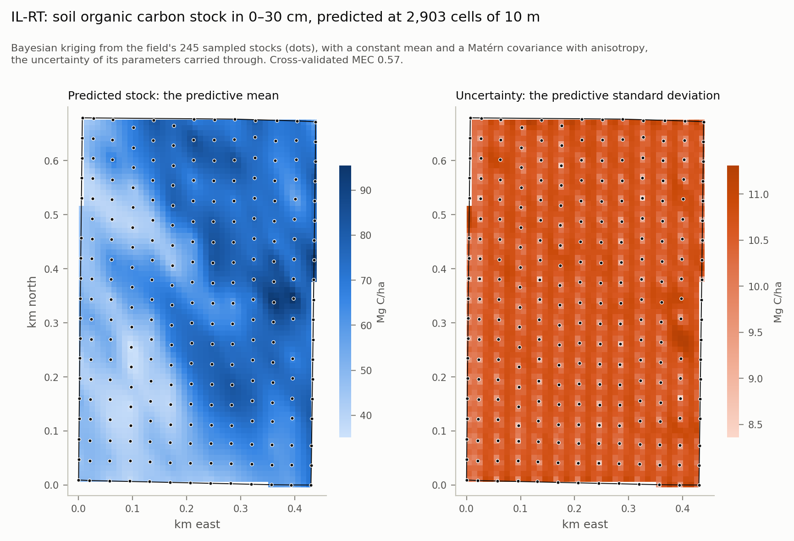
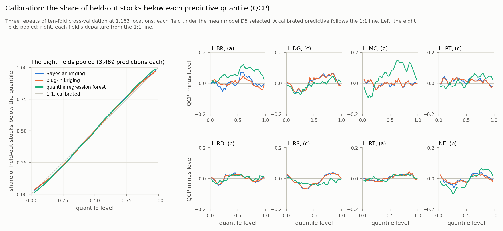

# Soil Carbon Kriging

**Soil organic carbon mapped with its uncertainty, in Python.** Ordinary
kriging and the kriging variance on field-scale carbon stocks from eight U.S.
Midwest fields, then on Germany's agricultural soil inventory, whose published
site locations are offset by up to 4 km for data protection.

**Author:** Dr. Adewole Olagoke · [aolagoke-dsae](https://github.com/aolagoke-dsae)

*IL-RT, one of the eight fields: the stock in 0–30 cm predicted at each 10 m cell by Bayesian kriging of 245 samples (dots), beside its uncertainty, lowest at the samples. In cross-validation the field's kriging has a modelling efficiency of 0.57, and its 90 % intervals hold 89.5 % of the held-out stocks.*

> **Status: Stage 4 run (08.11.2026, completed 10.11.2026): Checkpoint 4 passed, 13 of 13.**
> Both datasets are pulled and pass Checkpoint 1, 9 rules of 9; Stage 2
> passes Checkpoint 2, 9 of 9: the stocks, the REML covariance models with
> their intervals and the pooling test, and the gstat-style baseline beside
> them; Stage 3 passes Checkpoint 3, 6 of 6: eleven terrain covariates at
> every location, from the newest USGS 3DEP tiles; and Stage 4 passes
> Checkpoint 4, 13 of 13: Bayesian kriging cross-validated at all 1,163
> locations under three mean models, against two forests, its kriging
> checked against GSTools, and maps of all eight fields
> ([`RUNBOOK.md`](RUNBOOK.md), Stages 2 to 4). Each stage's rules are fixed
> by a commit before its data is touched; Stage 2's followed a review
> against current practice ([`docs/REVIEW_STAGE2.md`](docs/REVIEW_STAGE2.md)).

## Why

The author's spatial statistics go back to point-pattern analyses of tree
interactions in a regenerating mangrove forest (*Acta Oecologica*, 2013,
https://doi.org/10.1016/j.actao.2013.04.001), and the author's kriging so far was done
in R, with gstat, for a grassland study (*Journal of Vegetation Science*, 2023,
https://doi.org/10.1111/jvs.13196). This repeats that kriging in Python on open
soil-carbon data, with the variogram fitted by REML as current practice
recommends, and reports what soil-carbon work needs from it: not a smooth map,
but the uncertainty of each prediction and of each field's mean. A
machine-learning benchmark tests whether a forest does better.

## Data

| Source | What | Licence | How it is pulled |
|---|---|---|---|
| Potash (2023), [figshare 23669304 v2](https://doi.org/10.6084/m9.figshare.23669304.v2) | Soil organic carbon concentration and bulk density by depth segment, at georeferenced locations in eight commercial U.S. Midwest fields. Methods: Potash et al. (2023), *Geoderma* 438, 116587, https://doi.org/10.1016/j.geoderma.2023.116587 | CC BY 4.0 | figshare REST API, version pinned; each file checked against the size and MD5 the article states |
| Poeplau et al. (2020), [BZE-LW core dataset](https://doi.org/10.3220/DATA20200203151139) | 3,104 agricultural sites in Germany with the organic carbon stock in 0–30 cm, land use and soil description. **The coordinates are randomised within 4 km of each planned point, for data protection** | CC BY 4.0 | OGC WFS 2.0 from the Thünen Atlas, paged in `pointid` order; completeness checked against the total the server states |
| U.S. Geological Survey, [3DEP 1/3 arc-second DEM](https://www.sciencebase.gov/catalog/item/4f70aa9fe4b058caae3f8de5), through The National Map | Elevation in metres (NAVD 88) on a 1/3 arc-second grid, about 10 m, in tiles of 1 × 1 degree: for each tile under a Potash field, its newest version | Public domain (U.S. Government work) | TNM Access API for the versions; HTTP range requests for each tile's header and the blocks under the fields, 15.8 MB of 2.2 GB; the versions pinned in the manifest |

`raw/` is not committed: the clients fetch it again. `raw/manifest.csv` is,
and records every response's URL, status, size, SHA-256 and time. How to run
the pulls and the checkpoints is in [`RUNBOOK.md`](RUNBOOK.md), Stages 1 and 3.

## What is real

- **Real:** two ingestion clients built on `requests` (retries, timeouts,
  write-once storage, a manifest row per response); both datasets pulled and
  checked against their sources (Checkpoint 1, 9/9 rules); the 0–30 cm stock
  at 1,163 locations, checked against a second computation; REML for three
  covariance families and two mean models, written in NumPy and SciPy, its
  likelihood checked against scikit-learn's and its estimates on 50
  simulated fields; the REML fits to all eight fields under both mean
  models, with 95 % profile-likelihood intervals, the pooling test for the
  small fields, a Box-Cox profile per field and a geometric-anisotropy check
  for the large fields; the gstat-style moment baseline beside them, its
  semivariances and fits checked against scikit-gstat's (Checkpoint 2, 9/9
  rules); a third client, which reads only the parts of five USGS tiles
  under the fields by HTTP range requests, and from them slope and mean
  curvature at three scales, TPI at three and TWI at all 1,163 locations,
  checked against GDAL, direct least-squares fits, scikit-image and a
  sparse linear solve (Checkpoint 3, 6/6 rules); Bayesian kriging in NumPy
  and SciPy, its covariance parameters integrated over a grid inside Stage
  2's bounds, under a constant mean, a quadratic trend and terrain as an
  external drift chosen by AIC inside each training fold, with plug-in
  kriging beside it; a quantile regression forest and a random forest with
  kriged residuals, each trained across the eight fields; all of them
  scored at every location by three repeats of ten-fold cross-validation on
  the CRPS, PICP and QCP, and checked against the bordered kriging system,
  explicit inverses, Stage 2's REML likelihood, a calibration simulation and
  the trees' own leaves, and against GSTools, an independent geostatistics
  library, which reproduces its kriging within 10⁻¹⁴; maps of the
  predictive mean and standard deviation at every 10 m cell of the eight
  fields, checked against the cross-validation's own predictive
  (Checkpoint 4, 13/13 rules); 223 unit tests, none of which makes a
  request; a CI workflow for Python 3.11 and 3.14.
- **What Stage 4 found:** the selected kriging's 90 % intervals hold 88 to
  91 % of the held-out stocks at every field; carrying the parameters'
  uncertainty widens the predictive variance by 2 to 12 % against plug-in
  kriging; terrain as an external drift is selected at four fields of eight;
  the selected kriging scores better than the quantile regression forest at
  seven fields and better than the forest with kriged residuals at five;
  its mean squared deviation ratio (MSDR), 1.06 over the eight fields
  against plug-in kriging's 1.11, shows its variance about right where the
  plug-in's is too small ([`RUNBOOK.md`](RUNBOOK.md), Stage 4, *Result* and
  *Addendum: result*).

  
- **Not yet:** each field's mean stock by block kriging against the
  stratified, design-based estimate the paper evaluates (Stage 5), and the
  national-scale model for BZE-LW (Stage 6). Neither has its rules yet.

## Licence

Code: MIT ([`LICENSE`](LICENSE)). Data: CC BY 4.0, from the sources above,
attributed as their publishers ask in [`config/sources.csv`](config/sources.csv).
