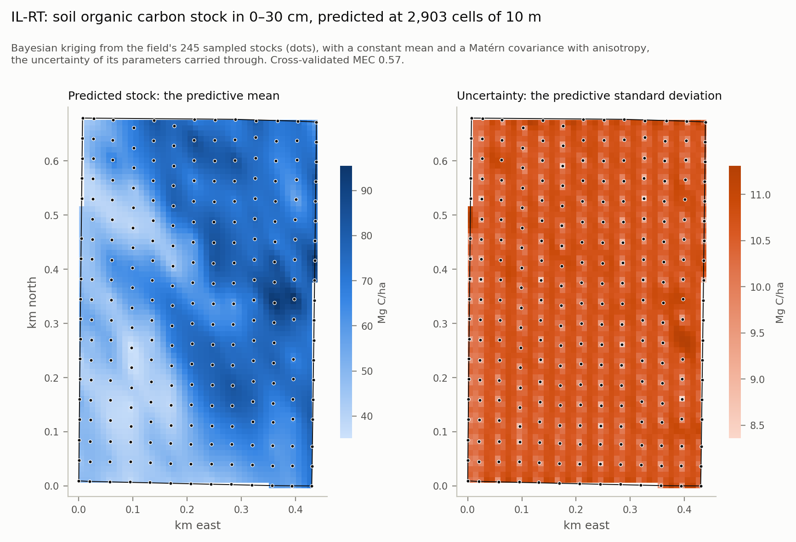
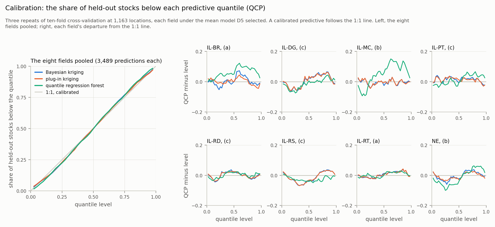

# Soil Carbon Kriging

**Soil organic carbon mapped with its uncertainty, in Python.** Bayesian
kriging of field-scale carbon stocks from eight U.S. Midwest fields, with the
uncertainty of every prediction and of each field's mean. Germany's
agricultural soil inventory, whose published site locations are offset by up
to 4 km for data protection, is pulled and checked; its model is Stage 6.

**Author:** Dr. Adewole Olagoke · [aolagoke-dsae](https://github.com/aolagoke-dsae)



*IL-RT, one of the eight fields: the stock in 0–30 cm predicted at each 10 m cell by Bayesian kriging of 245 samples (dots), beside its uncertainty, lowest at the samples. In cross-validation the field's kriging has a modelling efficiency of 0.57, and its 90 % intervals hold 89.5 % of the held-out stocks. IL-RT is shown because it is the field where kriging does best: across the eight fields the modelling efficiency runs from −0.04 to 0.57, and at IL-BR and IL-DG a map adds almost nothing to the field's mean.*

> **Status: Stage 5 run (14.11.2026): each field's mean stock, with what it means for monitoring.**
> The report: https://aolagoke-dsae.github.io/soil-carbon-kriging/
> Both datasets are pulled and pass Checkpoint 1, 9 rules of 9; Stage 2
> passes Checkpoint 2, 9 of 9: the stocks, the REML covariance models with
> their intervals and the pooling test, and the gstat-style baseline beside
> them; Stage 3 passes Checkpoint 3, 6 of 6: eleven terrain covariates at
> every location, from the newest USGS 3DEP tiles; and Stage 4 passes
> Checkpoint 4, 13 of 13: Bayesian kriging cross-validated at all 1,163
> locations under three mean models, against two forests, its kriging
> checked against GSTools, and maps of all eight fields; Stage 5 passes
> Checkpoint 5, 5 of 5: each field's mean by Bayesian block kriging, the
> samples needed and the detectable change, with R's gstat as a check
> ([`RUNBOOK.md`](RUNBOOK.md), Stages 2 to 5). Each stage's rules are fixed
> by a commit before its data is touched; Stage 2's followed a review
> against current practice ([`docs/REVIEW_STAGE2.md`](docs/REVIEW_STAGE2.md)).
> A pre-publication review of v1.0 ([`docs/REVIEW_V1.md`](docs/REVIEW_V1.md),
> 15.11.2026) is being worked through before Stage 6.

## Kurzfassung

Dieses Repository kartiert den organischen Kohlenstoffvorrat im Boden
(0–30 cm) mitsamt seiner Unsicherheit, in Python. Grundlage sind 1.163
georeferenzierte Proben aus acht landwirtschaftlich genutzten Feldern im
Mittleren Westen der USA (Potash et al., 2023); die Kovarianzmodelle werden
per REML geschätzt, Geländeparameter aus USGS-3DEP-Höhendaten dienen als
Kovariaten. In dreimal wiederholter zehnfacher Kreuzvalidierung halten die
90-%-Intervalle des bayesschen Krigings an jedem Feld 88 bis 91 % der
zurückgehaltenen Vorräte. Wird das Mittelwertmodell ohne die jeweils
zurückgehaltenen Daten gewählt, schneidet es im CRPS an sechs von acht
Feldern besser ab als der hier trainierte Quantile Regression Forest; ein
Random Forest mit gekrigten Residuen ist an vier Feldern besser. Der mittlere Vorrat je Feld, per
bayesschem Block-Kriging geschätzt, liegt an sieben Feldern zwischen 50,8 und
65,7 Mg C/ha; der niedrige Wert des achten (IL-BR, 21,8) stimmt mit der
US-Bodenkarte (SSURGO) überein, die Bestätigung durch den Autor steht aus. Um eine
Änderung von 10 % des Mittels zwischen zwei Beprobungen nachzuweisen, genügen
auf einem Raster mit Block-Kriging 13 bis 52 Proben, sofern das angepasste
Modell weiter gilt, statt 25 bis 103 bei einfacher Zufallsstichprobe. Die Regeln jeder Stufe werden per
Commit festgelegt, bevor ihre Daten verwendet werden; die Übertragung auf die
Bodenzustandserhebung Landwirtschaft (BZE-LW) des Thünen-Instituts folgt als
Stufe 6.

## Why

The author's spatial statistics go back to point-pattern analyses of tree
interactions in a regenerating mangrove forest (*Acta Oecologica*, 2013,
https://doi.org/10.1016/j.actao.2013.04.001), and the author's kriging so far was done
in R, with gstat, for a grassland study (*Journal of Vegetation Science*, 2023,
https://doi.org/10.1111/jvs.13196). This repeats that kriging in Python on open
soil-carbon data, with the variogram fitted by REML as current practice
recommends, and reports what soil-carbon work needs from it: not a smooth map,
but the uncertainty of each prediction and of each field's mean. A
machine-learning benchmark tests whether a forest does better.

## Quick start

```bash
pip install -r requirements-lock.txt       # the pinned versions CI tests; requirements.txt for the newest
python -m pytest -q
```

The pulls and every stage's commands are in [`RUNBOOK.md`](RUNBOOK.md).

## Data

| Source | What | Licence | How it is pulled |
|---|---|---|---|
| Potash (2023), [figshare 23669304 v2](https://doi.org/10.6084/m9.figshare.23669304.v2) | Soil organic carbon concentration and bulk density by depth segment, at georeferenced locations in eight commercial U.S. Midwest fields. Methods: Potash et al. (2023), *Geoderma* 438, 116587, https://doi.org/10.1016/j.geoderma.2023.116587 | CC BY 4.0 | figshare REST API, version pinned; each file checked against the size and MD5 the article states |
| Poeplau et al. (2020), [BZE-LW core dataset](https://doi.org/10.3220/DATA20200203151139) | 3,104 agricultural sites in Germany with the organic carbon stock in 0–30 cm, land use and soil description. **The coordinates are randomised within 4 km of each planned point, for data protection** | CC BY 4.0 | OGC WFS 2.0 from the Thünen Atlas, paged in `pointid` order; completeness checked against the total the server states |
| U.S. Geological Survey, [3DEP 1/3 arc-second DEM](https://www.sciencebase.gov/catalog/item/4f70aa9fe4b058caae3f8de5), through The National Map | Elevation in metres (NAVD 88) on a 1/3 arc-second grid, about 10 m, in tiles of 1 × 1 degree: for each tile under a Potash field, its newest version | Public domain (U.S. Government work) | TNM Access API for the versions; HTTP range requests for each tile's header and the blocks under the fields, 15.8 MB of 2.2 GB; the versions pinned in the manifest |

`raw/` is not committed: the clients fetch it again. `raw/manifest.csv` is,
and records every response's URL, status, size, SHA-256 and time. How to run
the pulls and the checkpoints is in [`RUNBOOK.md`](RUNBOOK.md), Stages 1 and 3.

## What is real

**Built and checked**

- **Ingestion:** three clients built on `requests` (figshare, the Thünen
  Atlas WFS, and The National Map by HTTP range requests), with retries,
  timeouts, write-once storage and a manifest row per response; both
  datasets checked against their sources (Checkpoint 1, 9/9 rules).
- **Stocks and covariance models (Stage 2):** the 0–30 cm stock at 1,163
  locations, checked against a second computation; REML for three
  covariance families and two mean models, written in NumPy and SciPy, its
  Gaussian likelihood checked against scikit-learn's and its estimates on 50
  simulated fields, with 95 % profile-likelihood intervals, the pooling test for the small fields,
  a Box-Cox profile per field and a geometric-anisotropy check; the
  gstat-style moment baseline beside them, checked against GSTools
  (Checkpoint 2, 9/9 rules).
- **Terrain (Stage 3):** slope, mean curvature and TPI at three scales and
  TWI at all 1,163 locations, from five USGS 3DEP tiles, checked against
  GDAL, direct least-squares fits, scikit-image and a sparse linear solve
  (Checkpoint 3, 6/6 rules).
- **Kriging and its benchmark (Stage 4):** Bayesian kriging with its
  covariance parameters integrated over a grid, under a constant mean, a
  quadratic trend and terrain as an external drift, plug-in kriging beside
  it, a quantile regression forest and a forest with kriged residuals; all
  scored at every location by three repeats of ten-fold cross-validation
  (CRPS, PICP, QCP, MSDR); the kriging reproduced by GSTools within 10⁻¹⁴;
  maps of all eight fields (Checkpoint 4, 13/13 rules).
- **Field means (Stage 5):** Bayesian block kriging of each field's mean,
  checked against a direct solve, a calibration simulation and R's gstat
  (Checkpoint 5, 5/5 rules).
- **Tests and CI:** 260 unit tests, none of which makes a request, four of
  them redrawing the report's figures from their committed tables; CI on
  Python 3.11 and 3.14 on Linux, 3.14 on Windows from the lock file, and the
  gstat check in R.

**What Stage 4 found** ([`RUNBOOK.md`](RUNBOOK.md), Stage 4, *Result* and
*Addendum: result*)

- The selected kriging's 90 % intervals hold 88 to 91 % of the held-out
  stocks at every field (84 to 91 % with the model chosen without the
  held-out fold). Its mean squared deviation ratio (MSDR), 1.06 over
  the eight fields against plug-in kriging's 1.11, shows its variance about
  right where the plug-in's is too small; carrying the parameters'
  uncertainty widens the predictive variance by 2 to 12 %.
- What a map adds varies by field: the modelling efficiency runs from −0.04
  at IL-BR to 0.57 at IL-RT, and at IL-BR and IL-DG kriging scores within
  2 % of the field's own distribution of stocks. Terrain as an external
  drift is selected at four fields of eight.
- Against this repository's two forests, trained across the fields on
  coordinates and terrain, with each held-out fold's mean model chosen on
  the other folds' scores (review, M1; RUNBOOK, Stage 4, *Addendum* on M1):
  kriging has the lower CRPS than the quantile forest at six fields and the
  higher at two; against the forest with kriged residuals it is lower at
  three, within 1 % at one and higher at four. Choosing the mean model on
  the reported scores, as v1.0 did, had flattered kriging by up to 9 % of
  CRPS (IL-MC).

  

**What Stage 5 found** ([`RUNBOOK.md`](RUNBOOK.md), Stage 5)

- Each field's mean stock in 0–30 cm lies between 50.8 and 65.7 Mg C/ha at
  seven fields. IL-BR's, 21.8, is low because its carbon content is (median
  0.56 % above 30 cm, against 1.6–1.9 % elsewhere), not because of its bulk
  densities: its 20 implausibly loose segments move its mean by 0.36 Mg C/ha.
  The USDA soil survey (SSURGO) agrees: it expects IL-BR's soils to hold
  about a third of the other Illinois fields' carbon. It awaits confirmation
  from the dataset's author (review, M5; RUNBOOK, Stage 1, *Addenda*).
- Block kriging and the sample mean agree at every field; the block-kriging
  interval is 6 to 46 % narrower at seven fields and 2 % wider at IL-BR.
  Against held-out samples, kriging from half of each grid field's samples
  predicts the other half's mean with 95 % intervals that hold 93.5 % of
  them, 19 % narrower than the sample mean's and with an 11 % lower CRPS;
  the gain is at IL-RT and IL-RS, while at IL-DG and IL-RD the narrower
  intervals score no better (review, M3). Tripling the prior's upper bound on the
  correlation range moves the three most exposed field means by at most
  0.003 Mg C/ha (review, M2).
- To detect a change of 10 % of the mean between two campaigns, 13 to 52
  samples on a grid with block kriging suffice if the fitted model carries
  over to the next campaign, against 25 to 103 by simple random sampling
  with the sample mean. These are fixed-depth stocks; monitoring change
  would compare them on an equivalent soil mass.

  

**Under review:** a pre-publication review of v1.0
([`docs/REVIEW_V1.md`](docs/REVIEW_V1.md)) found five major issues. They are
addressed before Stage 6, as dated addenda with their rules fixed first.

**Not yet:** the national-scale model for BZE-LW (Stage 6), which has no
rules yet.

## Licence

Code: MIT ([`LICENSE`](LICENSE)). Data: CC BY 4.0, from the sources above,
attributed as their publishers ask in [`config/sources.csv`](config/sources.csv).

To cite this repository: [`CITATION.cff`](CITATION.cff), shown by GitHub as
*Cite this repository*; the release is v1.0 (Stages 1 to 5).
