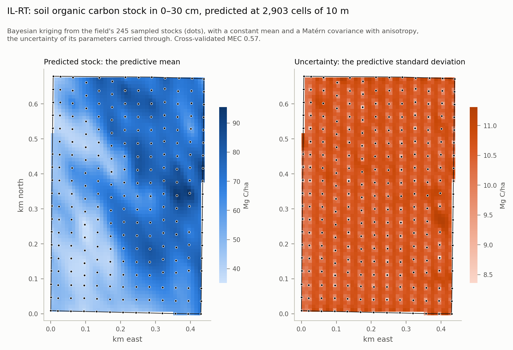
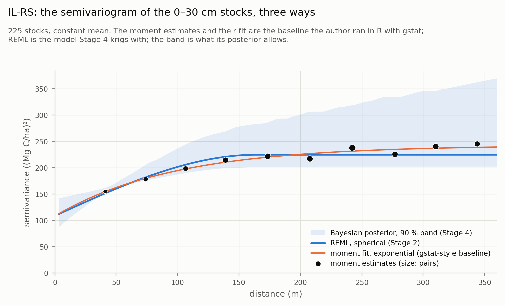
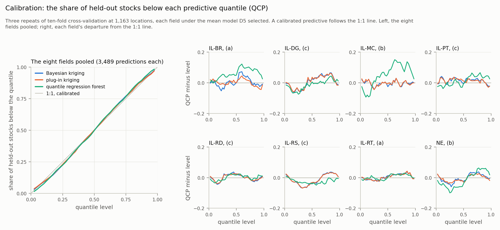
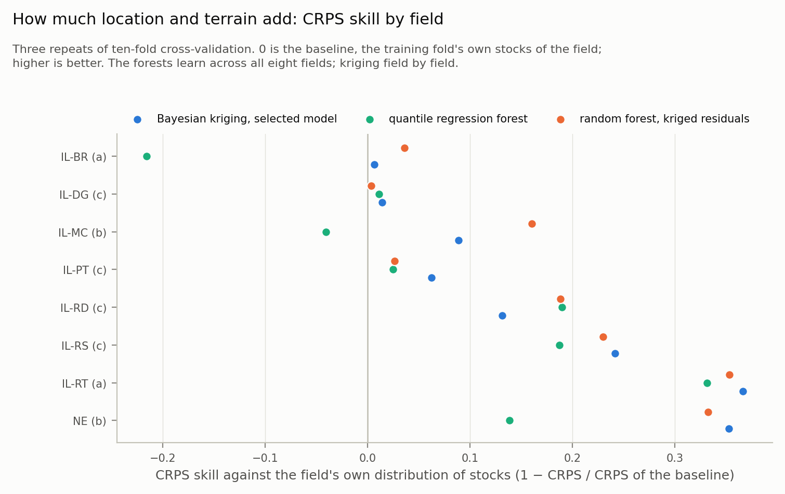
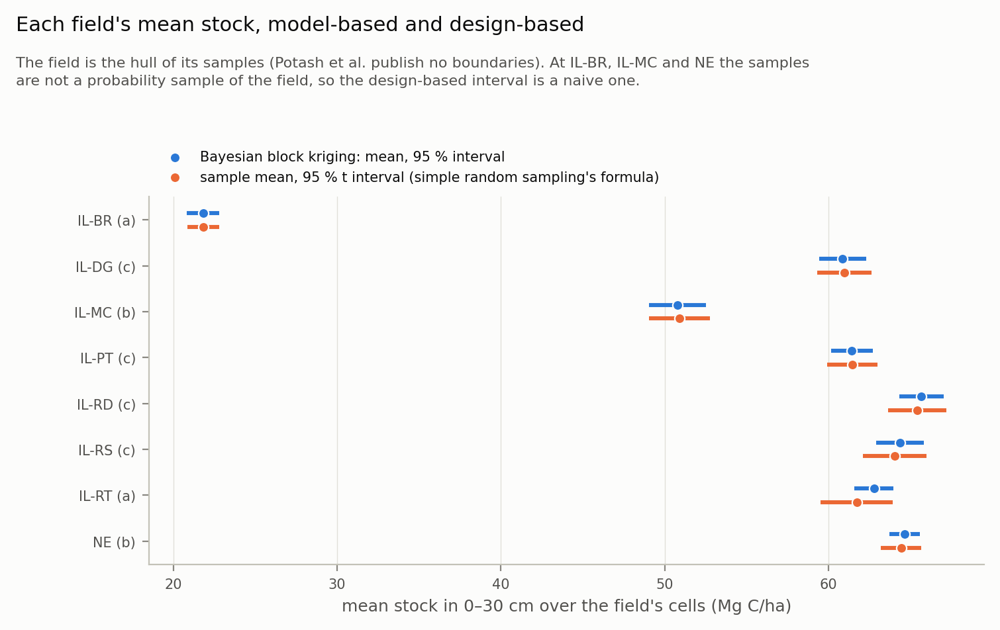
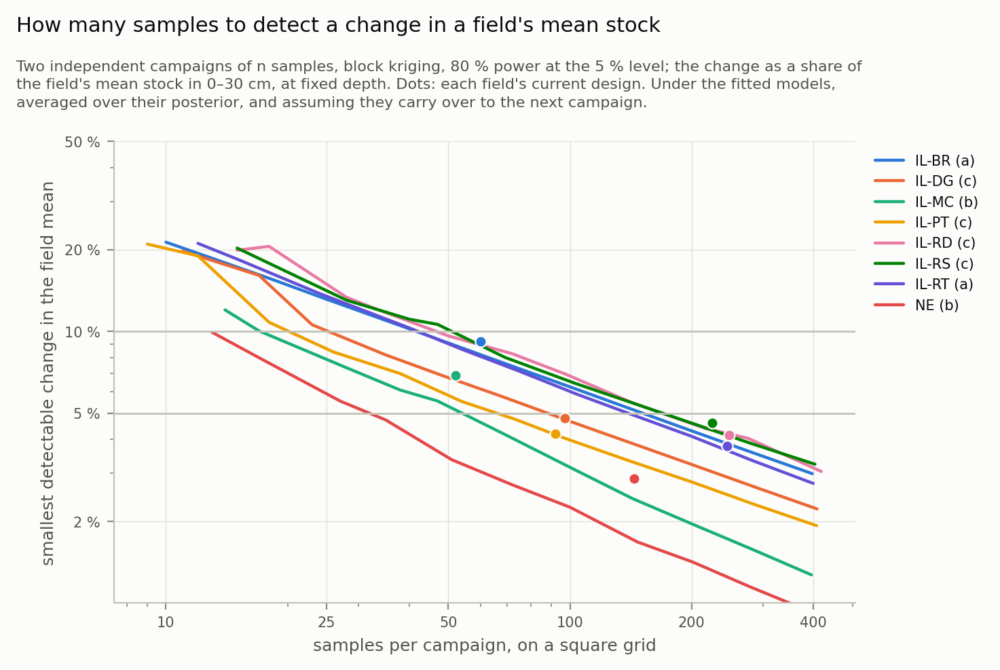

This report summarises a repository whose every number comes from code
checked by rules fixed before the data were touched; the rules, the checks
and every result are in its
[RUNBOOK](https://github.com/aolagoke-dsae/soil-carbon-kriging/blob/main/RUNBOOK.md).
Nothing on this page is computed when it is published: the figures and
their tables are made by `src/report/figures.py` and committed.

## The question

A carbon-farming scheme needs a field's mean soil carbon stock with an honest
interval, and needs to know how many samples it takes to detect a change in
it. The data are Potash et al. (2023): 1,163 cores in eight commercial
fields in Illinois and Nebraska, stocks computed here for 0–30 cm. The
field is the hull of its samples, since no field boundaries are published.

## Method

- **Covariance models by REML** for each field, with the pooling of the
  four small fields tested and a gstat-style moment fit beside them
  (Stage 2).
- **Bayesian kriging**: the covariance parameters integrated over a grid
  inside Stage 2's bounds, the mean and sill analytically; three mean models,
  a constant, a quadratic trend, and terrain from USGS 3DEP as an external
  drift chosen by AIC inside each training fold; each field's model chosen
  by CRPS (Stages 3 and 4).
- **Validation** by three repeats of ten-fold cross-validation at every
  location, on the CRPS, PICP, QCP and MSDR; against a quantile regression
  forest and a forest with kriged residuals trained across the fields.
- **The field mean** by Bayesian block kriging over the field's 10 m cells,
  beside the sample mean; the samples needed for a given precision and the
  smallest change two campaigns could detect (Stage 5).

## Are the intervals honest?

Pooled over the eight fields, the Bayesian kriging's predictive quantiles
lie within 0.03 of the 1:1 line and its mean squared deviation ratio is
1.06; plug-in kriging, which treats the parameters as known, has an MSDR
above the Bayesian's in all 24 combinations of field and mean model. The
quantile forest is calibrated where the fields are large and far too wide
at the small ones.

What a map adds varies by field. Kriging's modelling efficiency runs from
−0.04 at IL-BR to 0.57 at IL-RT, and at IL-BR and IL-DG it scores within 2 %
of the field's own distribution of stocks: there, a map adds almost nothing
to the field's mean. The selected kriging has a lower CRPS than the quantile
forest at seven fields, two of them by less than 0.4 %; with each field's
mean model fixed beforehand, at five, since the model was selected on the
same cross-validation. The forests here are trained across the fields on
coordinates and terrain only, so this compares kriging with these forests,
not with machine learning in general.

## Each field's mean stock

| Field | Block kriging, Mg C/ha | Sample mean | Smallest detectable change now |
|---|---|---|---|
| IL-BR | 21.82 (20.82–22.82) | 21.84 (20.87–22.82) | 2.01 (9.2 %) |
| IL-DG | 60.86 (59.42–62.32) | 60.96 (59.30–62.62) | 2.92 (4.8 %) |
| IL-MC | 50.79 (49.04–52.53) | 50.91 (49.05–52.76) | 3.51 (6.9 %) |
| IL-PT | 61.43 (60.15–62.71) | 61.46 (59.94–62.99) | 2.58 (4.2 %) |
| IL-RD | 65.67 (64.32–67.03) | 65.41 (63.64–67.19) | 2.72 (4.1 %) |
| IL-RS | 64.36 (62.90–65.83) | 64.03 (62.10–65.97) | 2.96 (4.6 %) |
| IL-RT | 62.77 (61.59–63.94) | 61.72 (59.53–63.91) | 2.37 (3.8 %) |
| NE | 64.66 (63.74–65.58) | 64.43 (63.21–65.65) | 1.86 (2.9 %) |

95 % intervals. The two estimates agree at every field; block kriging's
interval is 6 to 46 % narrower at seven fields and 2 % wider at IL-BR. Both
come from the same samples, so their agreement shows that they are
consistent, not that either is accurate. IL-BR's level is under review: its
carbon contents and bulk densities look implausible beside the other
fields'.

## How many samples?

To detect a change of 10 % of the mean stock between two independent
campaigns (80 % power, 5 % level), 13 to 52 samples per field on a square
grid suffice under the fitted models, against 25 to 103 by simple random
sampling; for 5 %, 32 to 170 against 97 to 410. These are planning figures
for fixed-depth stocks: monitoring change would use an equivalent soil
mass, and revisiting the same locations would need fewer. The grid figures
use block kriging and assume that the fitted model carries over to the next
campaign, which a grid of a dozen points could not re-estimate; the random
sampling figures use the sample mean.

## Checked against R

| R gstat | This repository |
|---|---|
| `variogram()`, `fit.variogram()` | `src/transform/variograms.py`, the moment baseline, checked against GSTools |
| likelihood fits (not in gstat) | `src/transform/reml.py`, REML, checked against scikit-learn |
| `krige()` at points | `kriging.evaluate`, Bayesian over the parameters; plug-in at the mode |
| `krige(..., block = )` | `field_means.block_grid`, Bayesian block kriging |
| `krige.cv()` | `src/transform/folds.py` and `kriging.run_stage`, ten-fold, three repeats |

At IL-RT's Matérn model with anisotropy, gstat 2.1-1 reproduces this
repository's predictions at all 2,903 cells within 10⁻¹⁴ and the field mean
within 3 × 10⁻⁹; its block variance differs by 2 × 10⁻⁵ of itself, a
discrepancy that is systematic on simulated fields and whose cause was not
found. The RUNBOOK records it, and that the tolerance was widened after it
failed. GSTools reproduces
the cross-validation's plug-in kriging within 10⁻¹⁴ in every field.

## Limits

The field is the hull of its samples; stocks are at fixed depth to 30 cm,
where the paper's profiles go deeper; the planning numbers assume the
fitted models hold for a later campaign; at IL-BR, IL-MC and NE the samples
are not a probability sample, so their design-based intervals are naive;
IL-BR's low level is unexplained by the published data. Each field's mean
model was selected on the same cross-validation that scores it, and its
covariance family, anisotropy and Box-Cox λ were chosen from all its stocks;
the prior bounds the correlation range where the data identify it least,
which matters most for a field mean. A review of this release lists these
and how they are being addressed:
[REVIEW_V1](https://github.com/aolagoke-dsae/soil-carbon-kriging/blob/main/docs/REVIEW_V1.md).

## Data

Potash, E., et al. (2023). Multi-site evaluation of stratified and balanced
sampling of soil organic carbon stocks in agricultural fields. *Geoderma*,
438, 116587. Data CC BY 4.0, figshare 23669304 v2. Terrain: USGS 3DEP 1/3
arc-second DEM, public domain.
